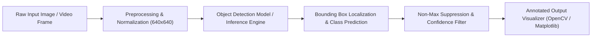

# 🚦 Traffic Sign Board Prediction & Detection System

[](https://www.python.org/)
[](https://opencv.org/)
[](https://tensorflow.org)
[](https://pytorch.org)
[](https://roboflow.com)
[]()

An end-to-end Computer Vision and Deep Learning system engineered for real-time traffic sign board detection, classification, and localization. Designed for Advanced Driver Assistance Systems (ADAS) and Autonomous Vehicle navigation, this project enables robust recognition of regulatory, warning, and speed limit signs under varying lighting conditions, distances, and angles.

---

## 📌 Table of Contents

- [Overview](#-overview)
- [Key Features](#-key-features)
- [Supported Traffic Sign Classes](#-supported-traffic-sign-classes)
- [Workflow Architecture](#-workflow-architecture)
- [Project Directory Structure](#-project-directory-structure)
- [Dataset Organization](#-dataset-organization)
- [Installation & Setup](#-installation--setup)
- [Inference & Usage](#-inference--usage)
  - [1. Inference via Roboflow API](#1-inference-via-roboflow-api)
  - [2. Tensor-Based Pipeline (TensorFlow)](#2-tensor-based-pipeline-tensorflow)
  - [3. Tensor-Based Pipeline (PyTorch)](#3-tensor-based-pipeline-pytorch)
- [Real-Time Video Processing](#-real-time-video-processing)
- [Future Enhancements](#-future-enhancements)
- [License](#-license)

---

## 📖 Overview

Road safety and autonomous navigation rely heavily on instantaneous and accurate understanding of road signs. This project provides:
- High-fidelity traffic sign recognition across diverse visual ranges (20ft, 30ft, 50ft+).
- Support for multiple deep learning inference backends (**PyTorch**, **TensorFlow**, and cloud/edge-optimized inference endpoints).
- Frame-level evaluation on real-time driving footage (`video.mp4` & sequentially extracted road frames).

---

## ✨ Key Features

- **Multi-Class Detection & Localization**: Detects bounding boxes and labels for 12 distinct traffic sign categories with confidence scores.
- **Distance-Variant Evaluation**: Comprehensive test sets covering multiple camera-to-sign distances (e.g., 20ft, 30ft, 50ft).
- **Multi-Framework Compatibility**: Ready-to-use pipelines for PyTorch tensors, TensorFlow tensors, and OpenCV visualization.
- **Real-Time Driving Video Benchmark**: Includes video assets and dense image sequences captured from real road driving scenarios.
- **Pre-processed & Standardized**: Auto-orientated pixel data resized to 640x640 with bounding box annotations.

---

## 🏷️ Supported Traffic Sign Classes

| # | Class Name | Category | Description |
|---|---|---|---|
| 1 | `20km` | Regulatory | Speed Limit 20 km/h |
| 2 | `30km` | Regulatory | Speed Limit 30 km/h |
| 3 | `40km` | Regulatory | Speed Limit 40 km/h |
| 4 | `50km` | Regulatory | Speed Limit 50 km/h |
| 5 | `60km` | Regulatory | Speed Limit 60 km/h |
| 6 | `80km` | Regulatory | Speed Limit 80 km/h |
| 7 | `Left_turn` | Mandatory / Direction | Mandatory Left Turn Ahead |
| 8 | `Right_turn` | Mandatory / Direction | Mandatory Right Turn Ahead |
| 9 | `Pedestrian_crossing` | Warning | Zebra / Pedestrian Crossing Zone |
| 10 | `School_zone` | Warning | Caution: School Zone Ahead |
| 11 | `Speed_bump` | Warning | Speed Breaker / Hump Ahead |
| 12 | `U_turn` | Mandatory / Direction | U-Turn Allowed / Lane |

---

## 🏗️ Workflow Architecture



---

## 📂 Project Directory Structure

```text
Traffic-Sign-board-prediction/
├── 1.Traffic sign main/               # Distance-stratified test images across classes
│   ├── 20km/                          # (20ft, 30ft, 50ft subsets)
│   ├── 30km/
│   ├── 40km/
│   ├── 50km/
│   ├── 60km/
│   ├── 80km/
│   ├── Left_turn/
│   ├── Right_turn/
│   ├── Pedestrian_crossing/
│   ├── School_zone/
│   ├── Speed_bump/
│   └── U_turn/
├── 2.Real time signs/                 # Real-time road camera footage & frame dataset
│   ├── video.mp4                      # Real-world driving test video
│   └── Data more in real time/        # Sequential high-density frames
├── 3.Dataset-Labled/                  # Multi-format annotated datasets
│   ├── Rightturn.v1i.tensorflow/     # TensorFlow Object Detection format
│   └── Rightturn.v1i.yolokeras/      # YOLO / Keras format
├── Total anno+Img Lable DataSet/      # Master dataset with train/valid/test splits
│   ├── train/                         # Training images & TFRecords
│   ├── valid/                         # Validation images & TFRecords
│   ├── test/                          # Test images & TFRecords
│   ├── README.dataset.txt
│   └── README.roboflow.txt
├── Objwork.ipynb                      # Primary experiment & detection notebook
├── Test.ipynb                         # Testing & scratchpad notebook
├── .gitignore                         # Git exclusion rules
└── Readme.md                          # Comprehensive project documentation
```

---

## 📊 Dataset Organization

- **Total Annotated Images**: 732+ curated and labeled images.
- **Real-Time Sequential Frames**: 9,900+ real-world road frames in `2.Real time signs/`.
- **Pre-processing**:
  - Auto-orientation with EXIF-orientation stripping.
  - Standardized resolution: `640x640`.
  - Train / Validation / Test splits formatted for direct model training and benchmarking.

---

## ⚙️ Installation & Setup

### 1. Clone the Repository
```bash
git clone https://github.com/Mithun017/Traffic-Sign-board-prediction.git
cd Traffic-Sign-board-prediction
```

### 2. Create and Activate a Virtual Environment
```bash
# Windows
python -m venv venv
.\venv\Scripts\activate

# Linux / macOS
python3 -m venv venv
source venv/bin/activate
```

### 3. Install Dependencies
```bash
pip install opencv-python matplotlib numpy requests torch torchvision tensorflow
```

---

## 🚀 Inference & Usage

### 1. Inference via Roboflow API

```python
import base64
import cv2
import matplotlib.pyplot as plt
import requests

def detect_traffic_sign(image_path, api_key, model_endpoint):
    with open(image_path, "rb") as image_file:
        image_base64 = base64.b64encode(image_file.read()).decode("utf-8")

    url = f"https://detect.roboflow.com/{model_endpoint}?api_key={api_key}"
    response = requests.post(
        url,
        data=image_base64,
        headers={"Content-Type": "application/x-www-form-urlencoded"}
    )
    return response.json()

# Example execution
api_key = "YOUR_API_KEY"
model_endpoint = "traffic-sign-rw6j9/1"
image_path = "1.Traffic sign main/Right_turn/20ft/Rt_20_9.jpg"

result = detect_traffic_sign(image_path, api_key, model_endpoint)

# Annotate image
img = cv2.imread(image_path)
for pred in result.get("predictions", []):
    x = int(pred["x"] - pred["width"] / 2)
    y = int(pred["y"] - pred["height"] / 2)
    w = int(pred["width"])
    h = int(pred["height"])
    
    cv2.rectangle(img, (x, y), (x + w, y + h), (0, 255, 0), 2)
    label = f"{pred['class']} ({pred['confidence']*100:.1f}%)"
    cv2.putText(img, label, (x, max(20, y - 10)), cv2.FONT_HERSHEY_SIMPLEX, 0.5, (255, 0, 0), 2)

img_rgb = cv2.cvtColor(img, cv2.COLOR_BGR2RGB)
plt.imshow(img_rgb)
plt.axis("off")
plt.show()
```

### 2. Tensor-Based Pipeline (TensorFlow)

```python
import cv2
import tensorflow as tf

image = cv2.imread("1.Traffic sign main/Right_turn/30ft/Rt_30_1.jpg")
image_rgb = cv2.cvtColor(image, cv2.COLOR_BGR2RGB)

# Convert to tensor and add batch dimension
image_tensor = tf.convert_to_tensor(image_rgb, dtype=tf.float32)
image_tensor = tf.expand_dims(image_tensor, axis=0)
print("TensorFlow Tensor Shape:", image_tensor.shape)
```

### 3. Tensor-Based Pipeline (PyTorch)

```python
import cv2
import torch
from torchvision import transforms

image = cv2.imread("1.Traffic sign main/U_turn/50ft/Ut_50_2.jpg")
image_rgb = cv2.cvtColor(image, cv2.COLOR_BGR2RGB)

transform = transforms.Compose([
    transforms.ToPILImage(),
    transforms.ToTensor()
])

image_tensor = transform(image_rgb).unsqueeze(0)
print("PyTorch Tensor Shape:", image_tensor.shape)
```

---

## 📹 Real-Time Video Processing

To run detection on a live webcam feed or recorded video (`2.Real time signs/video.mp4`):

```python
import cv2

cap = cv2.VideoCapture("2.Real time signs/video.mp4")

while cap.isOpened():
    ret, frame = cap.read()
    if not ret:
        break
    
    # Process frame (resize, normalize, run inference)
    # cv2.imshow('Traffic Sign Detection', frame)
    
    if cv2.waitKey(1) & 0xFF == ord('q'):
        break

cap.release()
cv2.destroyAllWindows()
```

---

## 🔮 Future Enhancements

- [ ] Real-time embedded deployment (NVIDIA Jetson / Raspberry Pi with TensorRT / ONNX).
- [ ] Integration with audio alerts for driver warning notifications.
- [ ] Synthetic data generation for adverse weather conditions (fog, heavy rain, nighttime).
- [ ] Integration with GPS mapping for location-tagged traffic sign logging.

---

## 📄 License

This project is open-source and available under the [MIT License](LICENSE).
